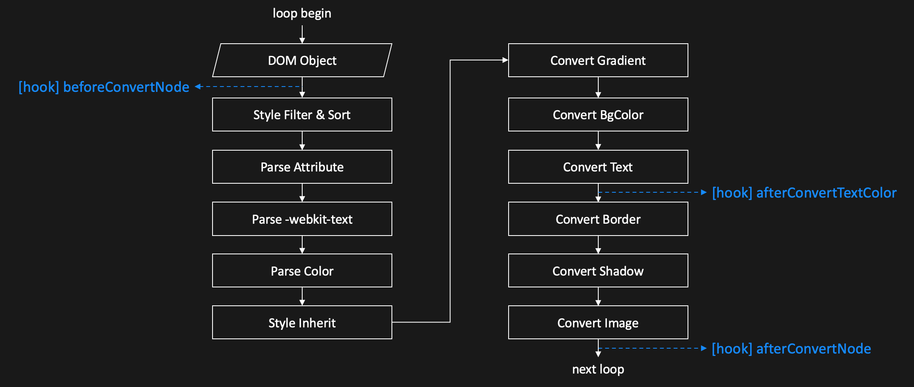

English | [简体中文](../cn/plugins.md)

Plugins
==============================

## How to use

```javascript
Darkmode.extend([pluginA, pluginB, pluginC]);
```

**Note:**

- `Darkmode.extend()` must be executed before the corresponding conversion (e.g. before the first-screen conversion), otherwise the plugins will not take part in that conversion.
- `Darkmode.reset()` **removes all mounted plugins** (and clears the plugin styles), so you need to call `extend` again after a reset.

## Make your plugin

### Overview

Darkmode will provide the plugin base class `Plugin` parameter through the `extend` method. When you write your own plugins, you need to inherit the plugin base class. Through the plugin base class you can access some built-in properties and methods, and you can use plugin hooks to write your own logic.

```javascript
export default function (Plugin) {
  return class extends Plugin {
    constructor() {
      super(); // The plugin base class contains some built-in properties and methods

      ... // Plugin properties can be customized here
    }

    // BEGIN: Plugin Hook
    beforeConvertNode(el) {}

    afterConvertNode(el) {}

    afterConvertTextColor(el, opt) {}
    // END: Plugin Hook

    ... // Plugin methods can be customized here
  }
};
```

### Built-in properties and methods

All built-in properties and methods can be accessed in plugins via `this`.

#### Built-in properties

- `loopTimes` &lt;number&gt; The number of completed traversal passes (one pass means all nodes have been traversed once).
- `isDarkmode` &lt;boolean&gt; Whether it is Dark Mode.

#### Built-in methods

##### `addCss(className, kvList, needMediaQuery)`

- `className` &lt;string&gt; DOM class name.
- `kvList` &lt;Array&gt; List of css key-value pairs.
  - `kvList[0].key` &lt;string&gt; CSS property.
  - `kvList[0].value` &lt;string&gt; CSS value.
- `needMediaQuery` &lt;boolean&gt; Whether the Dark Mode media query needs to be added. Defaults to `true`.

Add styles.

```javascript
this.addCss('test_class1', [{
  key: 'color',
  value: '#DDD'
}, {
  key: 'text-align',
  value: 'center'
}], true);

this.addCss('test_class2', [{
  key: 'cursor',
  value: 'pointer'
}], true);

// Result
// @media (prefers-color-scheme: dark) {.test_class1{color: #DDD !important;text-align: center !important;}.test_class2{cursor: pointer !important;}}
```

### Hooks



Hooks come in three groups, one for each conversion source. **Only one group is triggered for a given node in a single conversion**:

| | First conversion (`Darkmode.run()`) | Update style (`Darkmode.updateStyle()`) | Background re-conversion (`Darkmode.convertBg()`) |
| --- | --- | --- | --- |
| Before node conversion | `beforeConvertNode` | `beforeConvertNodeByUpdateStyle` | `beforeConvertNodeByReset` |
| After text color conversion | `afterConvertTextColor` | `afterConvertTextColorByUpdateStyle` | `afterConvertTextColorByReset` |
| After node conversion | `afterConvertNode` | `afterConvertNodeByUpdateStyle` | `afterConvertNodeByReset` |

When `Darkmode.convertBg()` processes a background (gradient / background image) area, it first **resets** the inherited attributes of the old and new nodes in that area, then re-runs the conversion — that re-run triggers the `ByReset` group instead of the first-conversion one.

The three hooks of the first conversion are described below; the other two groups take exactly the same parameters.

#### `beforeConvertNode(el)`

- `el` &lt;HTMLElement&gt; The node currently being converted.

Hook before the node starts transforming.

**Note:** If you operate on the node in this hook (such as modifying the inline style), it will affect the subsequent conversion results. If you don't want to affect the conversion result, it is recommended to use the [afterConvertNode()](#afterconvertnodeel) hook.

#### `afterConvertTextColor(el, opt)`

- `el` &lt;HTMLElement&gt; The node currently being converted.
- `opt` &lt;Object&gt; Text color object.
  - `opt.fontColor` &lt;Color Object | null&gt; The converted text foreground color; `null` when the algorithm cannot compute one.
  - `opt.bgColor` &lt;Color Object&gt; The background color used to compute the contrast.

Hook after the text style conversion.

**Note:**

- The `Color` object is based on [colorjs.io](https://www.npmjs.com/package/colorjs.io); do **not** use the API of another color library on it. When you need a CSS color string, use [`Darkmode.colorToCssString()`](./API.md#darkmodecolortocssstringcolor--csscolor) — calling `toString()` directly may return `hsl()` or percentage notations that older webviews do not support.
- This hook is only triggered when the node has **no background image** and a parent background color can be resolved.

```javascript
afterConvertTextColor(el, opt) {
  if (!opt.fontColor) return; // the algorithm could not compute a foreground color
  const fontColor = Darkmode.colorToCssString(opt.fontColor); // 'rgb(128, 127, 127)'
  const bgColor = Darkmode.colorToCssString(opt.bgColor);
}
```

#### `afterConvertNode(el)`

- `el` &lt;HTMLElement&gt; The node currently being converted.

Hook after the node conversion.
